# 第二课 教AI认识身边的物品：学生图文教程

**今天的任务**：自己拍样本、训练一个分类器，让电脑认出桌上的两种文具和空桌面。

组号：第＿＿组

**今天的流程**：准备程序 → 采集样本 → 训练 → 测试 → 保存

我们的两种文具：①＿＿＿＿＿＿　②＿＿＿＿＿＿　③空背景（什么都不放）

---

## 第0步　分好岗位

四个人，每人一个岗位，今天配合完成。

| 岗位 | 做什么 | 准备程序时装哪块积木 | 名字 |
|---|---|---|---|
| 摄像头员 | 插好摄像头，调清楚；采样时盯着画面，画面干净才喊“拍” | 积木① | |
| 摆放员 | 摆放文具，每次挪一挪，放好后**把手拿开** | 积木② | |
| 按键员 | 听到“拍”，**只按一下**数字键 | 积木③ | |
| 测试员 | 采样时画“正”字数数；训练好以后负责组织测试 | 积木④ | |

---

## 一、准备程序

### 第1步　打开Mind+

1. 在电脑桌面上找到 **Mind+** 图标。

2. 用鼠标**双击**它。
3. 等它打开，第一次可能要等一会儿，不要连着点很多次。

☐ Mind+打开了

---

### 第2步　接好摄像头　👉 摄像头员

1. 把摄像头的USB插头插到电脑的USB口上。如果已经插好了，跳过这一步。

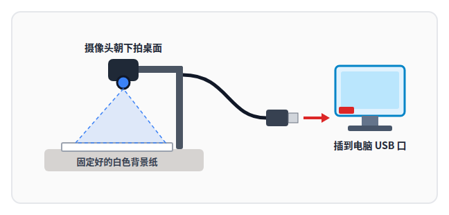

2. **不要**打开电脑自带的“相机”软件，它会占住摄像头，Mind+就看不到画面了。

☐ 摄像头插好了

---

### 第3步　打开今天的项目

1. 点左上角的 **项目**，再点 **打开项目**。

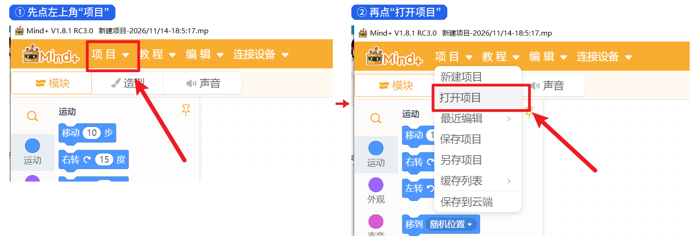

2. 在弹出的窗口里找到桌面上的 **第2课_学生版_待复原**，双击打开。
3. 看一看屏幕右上角，确认选中的是 **实时模式**。

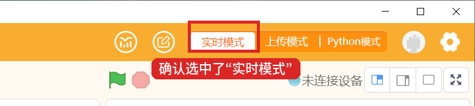

☐ 项目打开了

---

### 第4步　认识屏幕

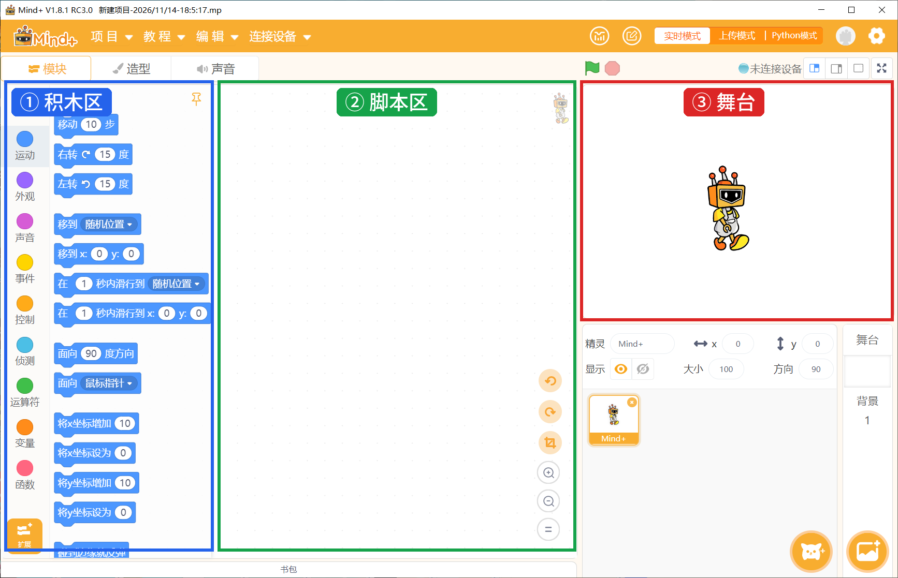

- ① **积木区**（左边）：所有可用的积木。
- ② **脚本区**（中间）：把积木拼成程序的地方。
- ③ **舞台**（右边）：显示识别结果的地方。

---

### 第5步　修好程序：装回4块积木

这个程序还缺了4块积木，它们在脚本区的**最下面**。把鼠标放在脚本区，用滚轮往下翻就能看到。

**每段程序做什么**：最上面那块圆顶积木写着“当绿旗被点击”或“当按下……键”。按一下对应的键，它下面的积木就会从上到下依次运行。

| 按什么 | 做什么 |
|---|---|
| 绿旗 | 打开摄像头，准备好分类器（会清空刚才拍的所有样本） |
| 1 | 把当前画面作为一个样本，加入第一个类别 |
| 2 | 把当前画面作为一个样本，加入第二个类别 |
| 3 | 把当前画面作为一个样本，加入“空背景”类别 |
| T | 训练分类器，完成后自动开始识别 |
| P | 暂停识别 |
| V | 把模型保存成文件 |
| S、L | 继续识别、读取模型（下节课用） |

**怎么拖积木**：用鼠标按住积木，拖到要放的位置。看到出现一条白线时再松手，积木就会吸上去。

#### 积木①　开启摄像头　👉 摄像头员来装

1. 找到写着 **当绿旗被点击** 的那段程序。
2. 把“**开启 摄像头**”拖到“**使用 弹窗 显示摄像头画面**”的下面、“**等待 5 秒**”的上面。

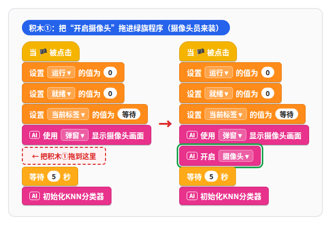

☐ 积木①装好了

#### 积木②③　把画面加入类别　👉 摆放员装②，按键员装③

1. 先看看 **当按下 3 键** 的程序：最下面一块是“KNN将摄像头画面分类为［空背景］”。
2. 1号和2号也缺了这样一块。
3. **摆放员**：把写着“**物品1**”的那块“KNN将摄像头画面分类为”拖到 **当按下 1 键** 的程序**最下面**。
4. **按键员**：把写着“**物品2**”的那块拖到 **当按下 2 键** 的程序**最下面**。

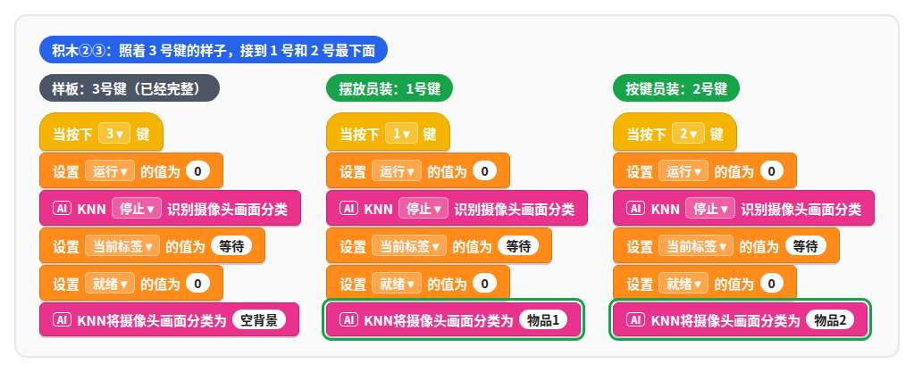

☐ 积木②装好了　☐ 积木③装好了

#### 设置两个类别的名称　👉 全组商量

选文具时记住：

- 两种要**长得不一样**，比如笔盒和橡皮。不要选两支差不多的笔。
- 要能**完整放进画面**，不要太大。
- 不选透明的、很细的东西，比如透明尺子。

1. 点1号键积木里的“**物品1**”，删掉，打上第一种文具的名字。
2. 点2号键积木里的“**物品2**”，删掉，打上第二种文具的名字。
3. 名称里**不要有空格**，两个类别不要重名。
4. 打完字，用鼠标点一下右边**舞台的空白处**。

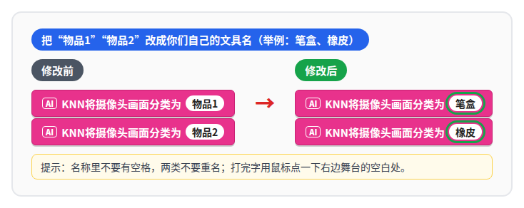

我们的类别名称：1号 ＿＿＿＿＿＿　2号 ＿＿＿＿＿＿

☐ 类别名称改好了

#### 积木④　开始分类训练　👉 测试员来装

1. 找到 **当按下 t 键** 的程序。
2. 把“**KNN开始分类训练**”拖到“**设置 当前标签 的值为 等待**”的下面、“**设置 就绪 的值为 1**”的上面。

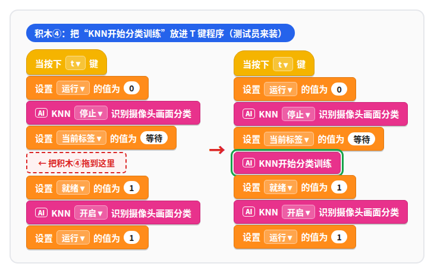

☐ 积木④装好了

#### 最后检查

☐ 最下面的4块积木**都装好了**

☐ 和老师屏幕上的完整程序对一对，位置一样

☐ 1号、2号已经改成我们的文具名

全部打勾，四个人一起举手！

---

## 二、采样前：分类器怎样识别

这一段先**听老师讲，不用操作电脑**。听完把空填上：

- 程序把每张照片变成一串＿＿数字，每个样本就是特征空间里的一个点。
- 来了一个新画面，它就找离它**最近的几个＿＿**，让它们投票。这个方法叫 **K近邻算法（KNN）**。
- 所以：按1、2、3 ＝ 在特征空间里加一个点；按T ＝ 训练，把所有点存好。

**采集样本的三条规则**：

1. **样本要多样**：换位置、转一转、翻个面、换一件。
2. **背景要一致**：三类都用同一张背景纸。
3. **画面中不出现手**：手在画面里，手也会被算进特征里。

---

## 三、采集样本

### 第6步　点绿旗，打开摄像头

1. 找到舞台上方的**绿旗**，点一下。

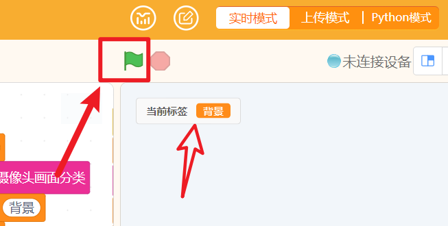

2. 等5秒左右，会弹出摄像头画面。

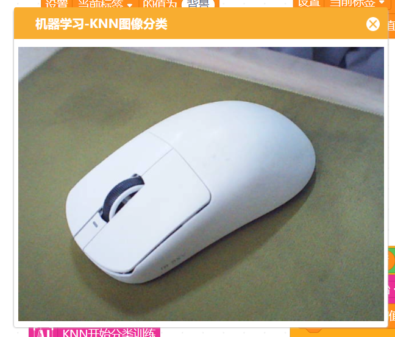

⚠ **绿旗只点一次**！点第二次会把刚才拍的所有样本全部清空。

☐ 看到摄像头画面了

---

### 第7步　调清楚，摆好背景　👉 摄像头员

1. **调焦距**：轻轻转动镜头前面那一圈，直到能看清文具上的字或花纹。

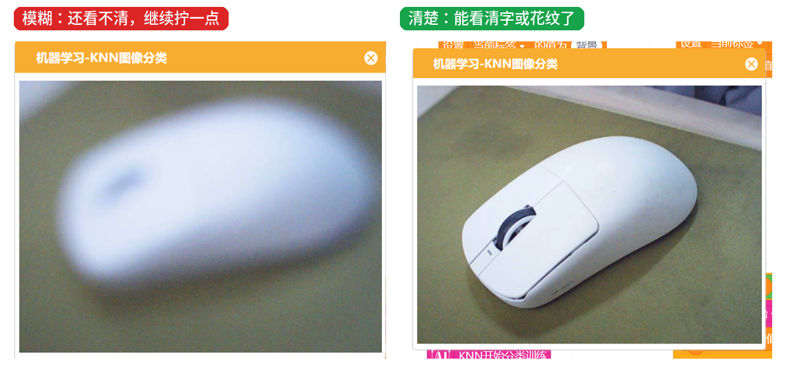

2. **调方向**：让白色背景纸**占满**画面，看不到桌子边。
3. 调好以后，**谁都不要再碰摄像头**。

☐ 画面清楚　☐ 背景纸占满画面

---

### 第8步　采集样本

**四个人按这个顺序配合**：

摆放员放好、手拿开 → 摄像头员看画面，喊“拍” → 按键员按一下 → 测试员画一笔

**口诀：放好 → 手拿开 → 看一看 → 按一下 → 挪一挪**

- 每按一次键，就加入一个样本。
- **按一下**，不是按住。连着按，得到的是一堆一样的样本。
- 每拍一次都要**挪一挪**：放左边、中间、右边，转一转，翻个面。有两件同样的文具，就两件都用上。

| 轮次 | 放什么 | 按哪个键 | 计数（画“正”字） |
|---|---|---|---|
| 第1轮 | 第一种文具 | **1** | |
| 第2轮 | 第二种文具 | **2** | |
| 第3轮 | 什么都不放 | **3** | |

每轮拍**10次**。第3轮拍空背景不用摆东西，摆放员可以和按键员换一下位置，换你来按键盘试试！

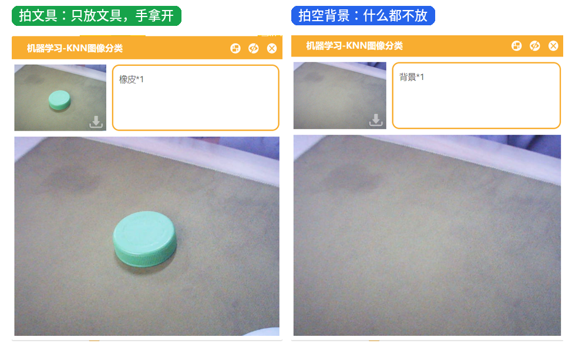

☐ 1号拍够了　☐ 2号拍够了　☐ 3号拍够了

---

## 四、训练和测试

### 第9步　按T，训练分类器

1. 按一下 **T** 键。
2. 等训练完成。训练时**不要按键**，按数字键会再加入样本。
3. 训练完，画面上方和舞台上会自动显示识别结果。

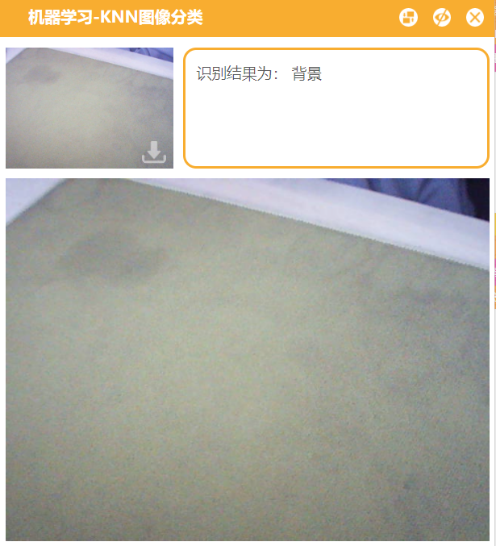

☐ 出现了识别结果

---

### 第10步　测试：先猜，再看　👉 测试员

测试员摆好测试物品。每次放之前，全组先**猜**它会说什么，再看画面和舞台上的名字。测试员把结果写下来。

| 次数 | 测试内容 | 我们猜 | 它说 | 对吗？（✓／✗） |
|---|---|---|---|---|
| 1 | 第一种文具，放到新位置 | | | |
| 2 | 第一种文具，换一件或翻个面 | | | |
| 3 | 第二种文具，放到新位置 | | | |
| 4 | 第二种文具，换一件或翻个面 | | | |
| 5 | 什么都不放 | | | |
| 6 | 放一个**没训练过**的东西：＿＿＿＿ | | | — |

**想一想**：第6次，它说出了一个名字。这说明它真的认识这个东西吗？为什么？

＿＿＿＿＿＿＿＿＿＿＿＿＿＿＿＿＿＿＿＿＿＿＿＿＿＿

---

## 五、保存

### 第11步　保存模型和项目

1. 按 **P** 键，暂停识别。
2. 按 **V** 键保存模型。在弹出的保存窗口里选桌面上**我们组的文件夹**，把文件名改成 **第＿＿组模型.json**（后面的 .json 不要删），点保存。

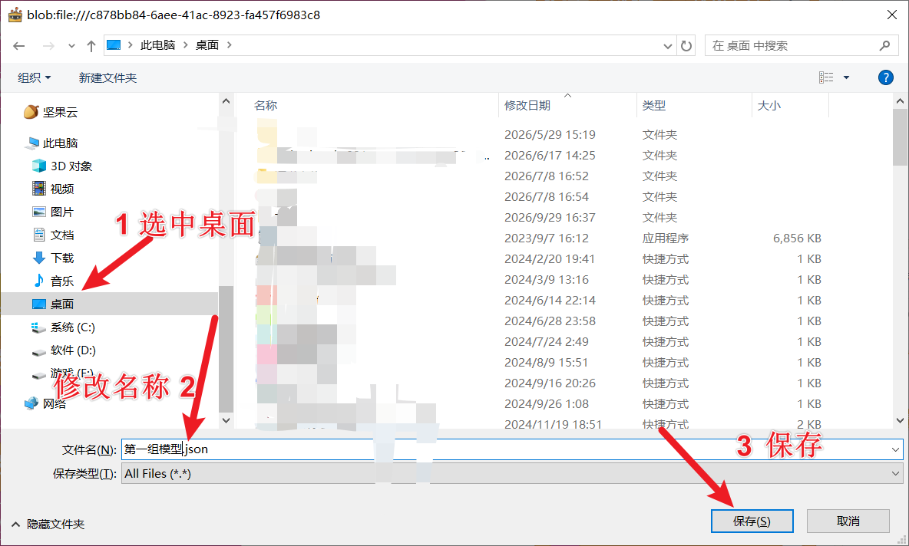

3. 点左上角 **项目** → **另存项目**，打开我们组的文件夹，文件名写：**第＿＿组_第2课**，点保存。

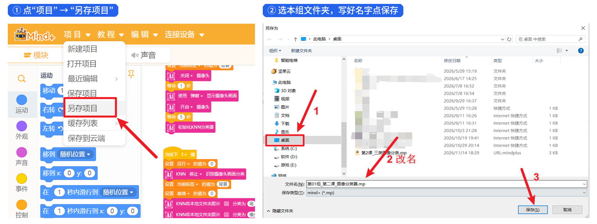

4. 打开桌面上的我们组文件夹，看看里面有没有这**两个文件**：
   - ☐ 项目文件（第＿＿组_第2课.mp）
   - ☐ 模型文件（第＿＿组模型.json）

---

## 遇到问题怎么办

| 发生了什么 | 先做这个 | 还不行 |
|---|---|---|
| 没有摄像头画面 | 关掉电脑自带的“相机”软件，等一会儿；看看积木①装好没有 | 举手找老师 |
| 按数字键，数字被打进了积木里 | 切到英文输入法，先点一下舞台空白处，再按 | 举手找老师 |
| 不管放什么都说同一种 | 检查1号、2号的名字改了没有，三类是不是都拍了 | 举手找老师 |
| 按T后等了很久 | **不要再按**，耐心等；看看积木④装好没有 | 超过2分钟举手 |
| 不小心点了绿旗或关掉了软件 | **不要再乱点** | 马上举手找老师 |

---

## 挑战卡：让分类器更准（提前做完第10步可以挑战）

1. 从测试记录里挑一次 ✗。没有 ✗ 的组，挑一个更难的摆法，比如竖着放。
2. 想一想：为什么会错？是不是这种摆法我们没采过样本？
3. 按 **P** 暂停。把文具摆成那种样子，按对应的数字键**补5个样本**（记得挪一挪）。
4. 按 **T** 重新训练。
5. 用**同一种摆法**再测一次。

| | 它说 | 对吗？ |
|---|---|---|
| 补样本之前 | | |
| 补样本之后 | | |

**一次只改一件事**，才知道是哪件事起了作用。

---

## 今天我学会了

我们的AI最会认＿＿＿＿＿＿，最容易认错＿＿＿＿＿＿，

我们觉得原因是＿＿＿＿＿＿＿＿＿＿＿＿＿＿＿＿＿＿。

**下节课别忘了**：下节课还要带今天这两种文具；电脑里我们组的文件夹也不要删掉。
